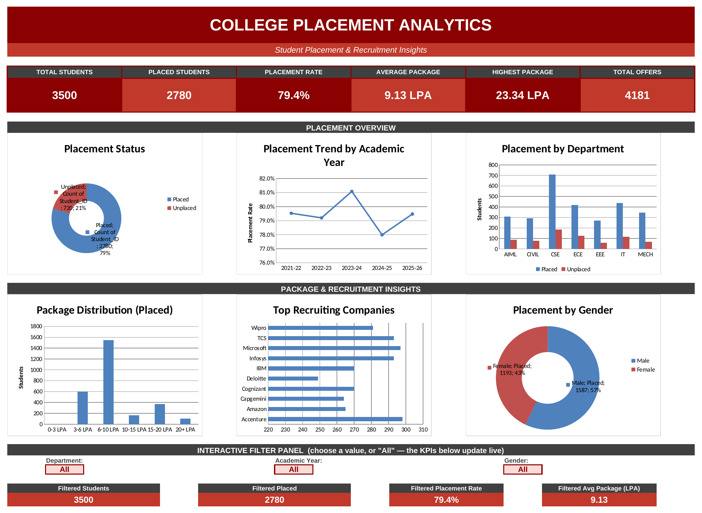

# 🎓 College Placement Analytics Dashboard

> An end-to-end **Microsoft Excel** data analytics project that turns 3,500 student records into placement KPIs, recruiter insights, salary analysis and an interactive red-and-white dashboard.


---

## 📌 Project Overview

Placement cells collect a lot of data but rarely turn it into decisions. This project answers questions a placement officer or college management would actually ask:

- What is the overall placement rate, and how does it vary by department, gender and academic year?
- Which companies hire the most students, and which pay the most?
- Do internships, certifications, CGPA and attendance really improve placement chances?
- How are packages distributed, and which departments and roles earn more?

All analysis is built with **Excel formulas** (not hard-coded numbers), so the workbook recalculates when the data changes.

---

## 📸 Dashboard Preview

> Add your screenshots to a `/screenshots` folder and update the paths below.

| Main Dashboard | Key Insights |
|---|---|
|  |  |

---

## 🗂️ Dataset

- **File:** `college_placement_analytics_3500.csv`
- **Size:** 3,500 student records, 22 columns
- **Coverage:** Academic years 2021-22 to 2025-26, 7 departments, 10 recruiting companies

| Group | Columns |
|---|---|
| Identity | `Student_ID`, `Academic_Year`, `Department`, `Gender`, `Age` |
| Academics | `CGPA`, `Attendance_Percentage`, `Backlogs`, `Projects_Completed` |
| Skills & Experience | `Internship_Count`, `Certifications`, `Aptitude_Score`, `Technical_Score`, `HR_Score` |
| Placement Outcome | `Placement_Status`, `Company`, `Industry`, `Job_Role`, `Package_LPA`, `Offer_Count`, `Placement_Date`, `Placement_Year` |

---

## 🧱 Workbook Structure

| Sheet | Purpose |
|---|---|
| **Dashboard** | Main presentation page — KPI cards, 6 charts, interactive filter panel, Key Insights |
| **Raw_Data** | Original dataset as an Excel Table (`tblPlacement`), all 3,500 rows untouched |
| **Data_Cleaning** | Data-quality checks: duplicates, missing values, invalid ranges, outliers |
| **Summary** | 16 KPIs, all formula-driven |
| **Pivot_Tables** | 12 pivot-style summary tables with charts |
| **Salary_Analysis** | Package bands (0–3 to 20+ LPA), by department, company and job role |
| **Student_Analysis** | How CGPA, attendance, internships, certifications, projects, scores and backlogs relate to placement |
| **Top_Students** | Top 10 by CGPA, package and technical score |
| **Recruiter_Analysis** | Hiring count, average/highest package, industry and roles per company |

---

## 🛠️ Excel Features Used

- **Excel Tables** with structured data and filters
- **Formulas:** `COUNTIFS`, `SUMIFS`, `AVERAGEIFS`, `MAXIFS`, `MINIFS`, `SUMPRODUCT`, `INDEX/MATCH`, `RANK`, `IF`, `IFERROR`, `TEXT`
- **Charts:** donut, column, line and bar charts
- **Conditional formatting:** color scales, data bars, and red/green status highlighting
- **Data validation:** dropdown filters on the dashboard
- **Dashboard design:** red/white theme, KPI cards, consistent fonts and spacing

> **Note on pivots & slicers:** the "pivot" sheets are **formula-driven summary tables** (COUNTIFS/AVERAGEIFS) rather than native Excel PivotTable objects, and the dashboard uses **dropdown filters** (Department / Academic Year / Gender) in place of native Slicers. They update automatically when the data changes.

---

## 📊 Key Findings

| Insight | Result |
|---|---|
| Overall placement rate | **79.4%** (2,780 of 3,500 students placed) |
| Average / highest package | **₹9.13 LPA** / **₹23.34 LPA** |
| Department with highest placement rate | **MECH** (83.3%) |
| Department with highest average package | **MECH** (₹9.38 LPA) |
| Company hiring the most students | **Accenture** (298 students) |
| Company with highest average package | **Microsoft** (₹19.56 LPA) |
| Best academic year | **2023-24** (81.1% placement rate) |
| Internships and placement | **81.0%** with internships vs **72.2%** without |
| Certifications and placement | **79.8%** with certifications vs **77.1%** without |
| CGPA and placement | Placed students average **7.76** CGPA vs **7.26** for unplaced |
| Multiple offers | **1,085** students received more than one offer |

**Takeaways:** internships and higher CGPA show the strongest link to placement, and placement rate rises steadily with attendance and CGPA bands.

---

## 🚀 How to Use

1. Download `College_Placement_Analytics_Dashboard.xlsx`.
2. Open it in **Microsoft Excel** and click **Enable Editing** if prompted.
3. Start on the **Dashboard** sheet and use the dropdowns (Department, Academic Year, Gender) to filter the KPIs.
4. Explore the other sheets for detailed analysis.
5. To use your own data, paste it into `Raw_Data` (keeping the same column order) — the formulas recalculate automatically.

---

## 📁 Repository Structure

```
├── College_Placement_Analytics_Dashboard.xlsx
└── README.md
```

---

## 💡 Skills Demonstrated

Data cleaning & validation · KPI design · Excel formula modelling · Exploratory analysis · Data visualization · Dashboard design · Business storytelling

---

## 👩‍💻 Author

**Vijayalakshmi R** — aspiring Data Analyst based in Bangalore, India

- 💻 GitHub: [github.com/vijeelakshmi](https://github.com/vijeelakshmi)

---

⭐ If you found this project useful, consider giving the repo a star!